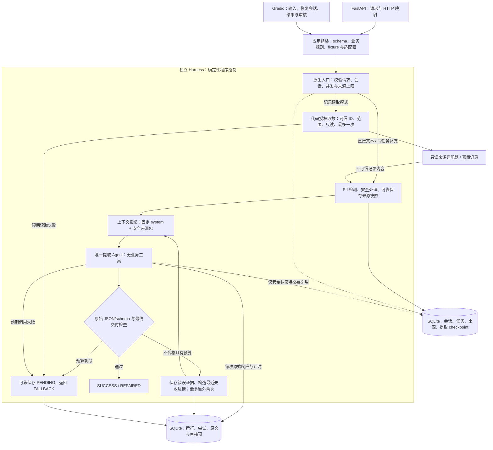

# 客户对话提取 Harness：当前架构与控制流

日期：2026-10-18。当前采用代码授权取数、一个无业务工具的提取 Agent，首次提取与修复共用模型配置。正式契约以[设计规格](specs/2026-10-18-support-extraction-harness-design.md)与[上下文话术](PROMPT_CONTEXT.md)为准；旧双角色拓扑由 [ADR-0008](adr/0008-use-one-tool-free-extraction-agent.md) 替代。

## 1. 模块与数据流

授权拒绝、输入拒绝及安全处理/持久化/内部故障通过领域错误出口返回，由适配器映射 HTTP；图中的 REVIEW 仅在审核保存确认成功后产生 FALLBACK。

入口 → 应用组装 → Harness，核心不依赖 FastAPI、Gradio、HTTP 对象或页面 State。模型、来源读取、持久化、审计及审核能力注入。来源适配器是普通代码能力，不注册给模型；输入文字和模型输出都不能新增读取调用。

## 2. 模型与代码的职责

| 程序代码负责 | 提取 Agent 负责 |
|---|---|
| 校验请求、来源授权、只读取数和次数 | 理解来源中的业务问题 |
| PII 检测、安全处理、来源可靠保存 | 生成六字段 JSON |
| system/来源/修复消息的投影 | 根据具体校验反馈纠正结果 |
| 严格校验、预算、计时与错误记录 | 按来源事实判断分类与紧急程度 |
| 会话/任务隔离、审核保存和最终状态 | 不拥有其他执行职责 |

提取 Agent 工具配置为空。恶意来源或异常模型响应要求读取其他记录、发邮件或退款时，不存在执行该请求的分支。字段合法不意味着语义正确，行动项只用于记录和展示。

## 3. 原生 middleware 与唯一恢复控制

沿用 LangChain 原生 middleware，先返回 JSON 文本再由控制层校验。职责可合并为少量类，不要求为每个 hook 建一层抽象。

| 控制点 | 职责 |
|---|---|
| 原生入口 / before_agent | 绑定可信上下文、接收或读取来源、检查限制并保存来源，初始化本次运行 |
| before_model | 检查运行可继续、总截止时间和调用预算，投影本次模型上下文 |
| wrap_model_call | 记录单次真实调用开始/结束、原始响应或异常、耗时；不在 wrapper 内重复调用 |
| after_model | 校验本次真实响应与安全处理后的交付对象；成功终止，失败生成反馈并跳转修复或耗尽终止 |
| 原生执行出口 | 形成领域结果；预期失败可靠转人工，持久化或内部故障为服务错误 |

实际调用开始前记录尝试和预算消耗，异常不能漏计。before hooks 正序、after hooks 逆序，wrap hooks 第一项最外层；跳转可能跳过其他 after hook，调用异常也不会正常进入 after_model，因此计时和必要审计覆盖 wrapper 与原生出口。实施时锁定依赖并验证实际跳转/异常行为。

主链无 wrap_tool_call、ToolMessage 配对、return_direct 或特权 Agent 的二次执行。输出修复的唯一所有者仍是 RecoveryMiddleware，不启用 ToolStrategy 自动纠错或 SDK 自动网络重试。

| 单次运行上限 | 直接文本 / 同任务补充 | 记录读取模式 |
|---|---:|---:|
| 提取模型调用 | 3 | 3 |
| 额外修复 | 2 | 2 |
| 指定记录读取 | 0 | 1 |

修复使用同一来源快照，不重新读取，不重置预算。模型和来源读取异常不进入格式修复；原文脱敏或安全处理失败停止模型外发。

## 4. 上下文投影与多轮记忆

首次模型请求为固定 system + 本任务完整安全来源包；修复时仅增加最近一次失败的安全反馈包。来源按 sequence 排序，补充与明确修正保留来源身份；错误约束由代码生成，失败正文保持不可信身份。[上下文契约](PROMPT_CONTEXT.md)提供可直接用于后续实现的模板与例子。

SQLite 保存 session → 当前 task、来源版本和提取 thread 的稳定关联；当前只维护一个提取 Agent 的 checkpoint。每次用户提交创建新 requestId，并初始化当前结果、错误和预算；不能从旧 checkpoint 自动回放所有 messages。模型历史答案仅供展示和审计，旧修复对话不进入新运行。

先保存来源补充，再调用模型；提取失败不撤销已保存修正。来源保存失败不开始模型调用；超限或并发拒绝不追加。同任务并发拒绝重入，新 session/task 不继承其他客户事实。

脱敏来源随会话生命周期保留，会话默认连续七天未使用后过期；原始来源和模型原始输出按各自保存时间默认七天到期。活跃会话不能延长旧原文保留，原文到期明确显示。重启恢复上下文，不刷新最后使用时间、不续跑中断调用；中断保留计数并可靠转人工。来源及中断决定见 ADR-0004 至 ADR-0007。

## 5. 观测、审核与验证

事件关联 session/task/request、来源版本与 attempt，记录每次模型耗时、实际次数、修复数、安全错误签名、读取允许/拒绝及最终状态。记录话术版本，原文与失败响应仅进入受控审计；普通日志、错误和默认页面脱敏。读取计时与模型计时分开，不再使用模型工具调用标识。

FALLBACK 必须有可靠保存且可查询的 PENDING 审核项；保存失败返回服务错误。来源接收成功与提取成功分开记录，页面必须依据已知持久化事实展示，不能把所有 HTTP 500 都说成补充未保存。

自动化测试用模型替身运行真实 middleware、代码读取策略和临时 SQLite。重点验证三次调用硬上限、修复不重复取数、来源授权拒绝时读取未执行、实际 messages 无旧答案/旧修复/敏感原值、模型无业务工具，以及审核与会话生命周期。完整验收见规格第 8 节，不单独维护第二套清单。

真实模型评测至少覆盖四个原题样例、记录内容注入、多轮补充及攻击前后业务分类一致性；记录实际模型、配置与话术版本。替身证明控制流与边界，真实评测证明已测试样例表现，均不保证所有业务事实或所有攻击。

## 6. 生产扩展与实施顺序

每分钟 10,000 次约为每秒 167 次业务操作；平均模型请求量约为业务量乘以 1 + 平均修复次数，最坏每次三次生成。生产扩展说明覆盖异步并发、供应商配额、限流与背压、统一截止时间、共享持久化、幂等和未知调用结果，以及敏感数据访问和保留。本地 SQLite 部署不承诺达到该吞吐量。

后续实施顺序为核心领域契约与注入接口 → schema/上下文投影/恢复/审计/审核 → SQLite 多轮、生命周期与代码取数 → FastAPI/Gradio → 自动化验证、真实评测与交付说明。当前任务仅更新设计文档。
